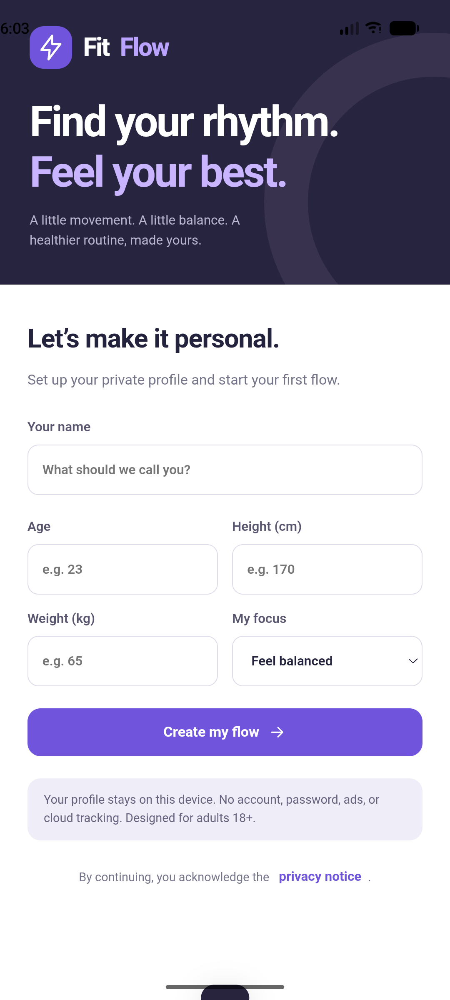
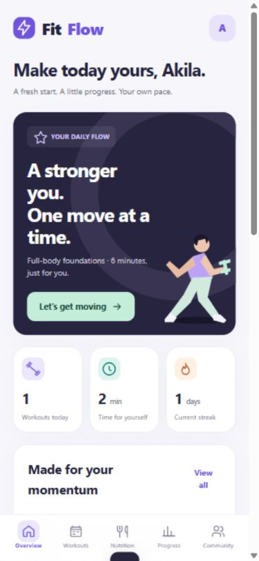
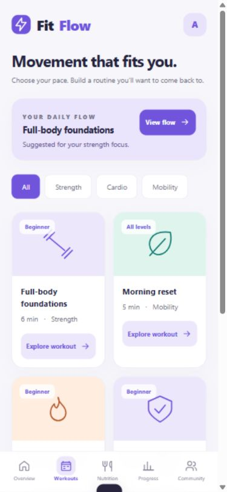
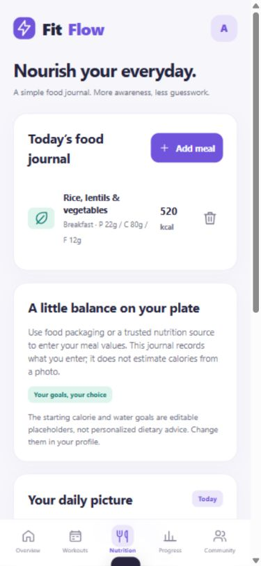
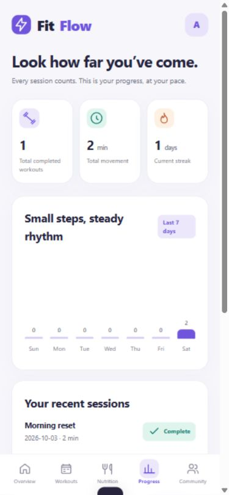

# FitFlow - IT3060 Lab Exercise 06

SLIIT · BSC (HONS) IN INFORMATION TECHNOLOGY

FitFlow
Find your rhythm.

IT3060 - Human Computer Interaction
Lab Exercise 06 | Year 3, Semester 2, 2026

| Student details |  |
| --- | --- |
| Name | Weerasingha V.P.K.P.A.T |
| Student ID | IT23379442 |
| Group | WE_07 |
| Campus | Not provided by student - confirm before submission |
| Prepared | 3 October 2026 |
| Support contact | akilatheshan23@gmail.com |

Original application and implementation report. Repository: https://github.com/akilatheshan23-lang/HCI_lab_06

---

REPORT GUIDE

Scope and evidence

This report follows the six activities in the supplied campus lab sheet. The CourseWeb case study itself was not supplied. The supplied IT23543164 report was reviewed for structure and screen coverage only; its identity, screenshots, wording, credentials and tester claims are not used as evidence for this project.

| Section | Implementation / evidence status |
| --- | --- |
| Activity 1 - Signed build | Signed, optimized Android APK generated and verified; emulator install/launch. AAB and broad compatibility testing pending. |
| Activity 2 - Store assets | Original branding, adaptive icons, feature graphic, actual Android and responsive browser captures. Native Apple captures pending. |
| Activity 3 - Google Play | Metadata and configuration plan prepared; account verification, AAB upload and internal track pending. |
| Activity 4 - Apple / TestFlight | Preparation and prerequisites documented. No iOS project/binary, upload or tester invitation. |
| Activity 5 - Privacy / release notes | Implementation-matched notice and release notes; support email supplied; repository policy link included. |
| Activity 6 - Internal testing | Observed local interaction checks and emulator smoke test. Store-track deployment, human feedback and approval pending. |

## Product boundary

FitFlow is a local-first Android application with a responsive browser interface. Working features include profile setup, timed movement routines, food and water journals, real recorded progress, weight check-ins and private community notes. Daily Flow uses a local rule set, not a generative AI service. Community content is a clearly labeled demonstration, not a live social network.

No cloud authentication, backend service, telemetry SDK, iOS build or store deployment is claimed. The APK can be installed for coursework testing; this does not mean the app is production-ready. A campus field remains unconfirmed.

---

ACTIVITY 1

Generate a signed APK

## 1.1 Release configuration

| Property | Recorded value |
| --- | --- |
| App / package | FitFlow / lk.fitflow.it23379442 |
| Version | 1.1.0 (versionCode 2) |
| Platform | Android; Java shell + packaged HTML/CSS/JavaScript |
| Compatibility configuration | minSdk 26; targetSdk 36; SDK Build Tools 36.1.0 |
| Artifact | FitFlow-1.1.0-release.apk |
| Artifact size | 42,190 bytes (41.2 KiB) |
| Optimization | R8 release shrinking, optimization and obfuscation; compressed ZIP assets; zipalign |
| Signature verification | APK Signature Scheme v2 and v3: true |

The repository initially contained no application source or commits. Version 1.1.0 (2) establishes incremented lab release numbering; it is not evidence of an earlier published app.

## 1.2 Build pipeline

AAPT2 compiles and links adaptive launcher resources and the manifest. javac compiles the native shell. R8 creates optimized DEX with an explicit keep rule for MainActivity. The packaged web UI and DEX are compressed into the APK, zipalign runs before signing, and apksigner signs and verifies the final file. The script fails immediately when a required tool or build step fails.

Build command: python scripts/build_android.py
Preview command: python scripts/serve.py
Required environment: JDK 17+, Python 3, Android Platform 36 and Build Tools 36.1.0. Set JAVA_HOME and ANDROID_HOME for non-default installations.

## 1.3 Integrity

SHA-256: b8015012dec12b6a889bdc70ae1c9820342900c476024f6594d0f4e62e425eda

Supporting files: releases/build-info.json, releases/signature-verification.txt, android/AndroidManifest.xml, android/proguard-rules.pro and scripts/build_android.py. The result is an APK, not an AAB. Google Play bundle generation remains outstanding.

---

ACTIVITY 1 · CONTINUED

Signing and device evidence

## 1.4 Keystore management

A new 3072-bit RSA signing key was generated under .private/fitflow-release.jks. The alias is fitflow-release. Its randomly generated password is in .private/signing-password.txt; both are excluded from Git. The build reuses the existing key. Keep an encrypted owner-controlled backup, limit access and never put the password in source, screenshots, public reports or CI logs.

For future updates, retain the same signing identity, increment manifest versionCode/versionName and preserve the R8 mapping alongside the release. The certificate is a local coursework signing identity; Google Play App Signing enrollment has not happened.

Figure 1. Actual installed Android application on the Pixel 7 emulator. This is emulator evidence, not a Play Store installation.

Installation and launcher smoke test succeeded. The Android minimum-version setting is a compatibility configuration, not proof that every supported OS/device has been tested. Java API deprecation warnings were emitted during compilation; they did not prevent signature verification or emulator launch.

---

ACTIVITY 2

Branding and store assets

## 2.1 Visual direction

The redesign replaces the reference report’s green visual identity with violet, mint and warm neutral accents. A dark hero panel anchors the dashboard, while white cards separate progress, nourishment and hydration. Navigation uses a desktop side rail and a fixed mobile bottom bar. The app uses consistent rounded controls, readable headings, visible focus rings and labeled icon actions.

| Token / asset | Value / purpose |
| --- | --- |
| Primary violet | #7054DC - primary actions and selected navigation |
| Ink | #24233D - main text |
| Mint / teal | #DFF4ED / #127B72 - wellbeing and hydration |
| Canvas | #F6F6FB - soft neutral background |
| Launcher assets | mdpi to xxxhdpi PNGs; adaptive foreground/background XML |
| Store icons | 512 x 512 RGB Play icon; 1024 x 1024 master icon |
| Feature graphic | 1024 x 500 RGB PNG; original typographic composition |

Figure 2. Original FitFlow feature graphic. Asset dimensions match the cited Google Play feature-graphic requirement.

The illustration and marks are code-drawn original assets. The friend’s screenshots and campus logos were not reused. Proposed listing copy is provided in store-assets/listing-copy.md.

---

ACTIVITY 2 · UI EVIDENCE

Dashboard and workouts

Figures 3-4. Actual responsive browser captures at a 390 x 844 viewport. Data belongs to a local test profile; these images are not iOS device screenshots.

## Interaction design

The dashboard starts with a goal-based Daily Flow, followed by current-day totals and suggested routines. The workout page supports category filtering and a detailed movement list. Timed sessions show the current step and remaining time; pause/resume and skip controls provide user control. Only actual elapsed time is recorded, and sessions shorter than 30 seconds are not added to progress.

A narrow 320 px layout issue was found during visual inspection: artwork overlapped the call-to-action. The illustration is now hidden at the smallest breakpoint and reduced on larger phone layouts. The call-to-action remains readable and tappable.

---

ACTIVITY 2 · UI EVIDENCE

Nutrition, progress and community

Figures 5-6. Actual nutrition and progress screens. The sample meal was entered during testing; the completed test session recorded 90 seconds, displayed as 2 minutes after rounding.

Meal totals are calculated from user-entered values. Water is stored by local date with an undo action. The activity chart uses recorded sessions rather than fabricated activity. Community notes and sample posts are explicitly labeled local-only. Additional community and tablet evidence is included in docs/evidence/.

---

ACTIVITY 3

Prepare Google Play Console

## 3.1 Prepared listing

| Field | Prepared value |
| --- | --- |
| Name / category | FitFlow / Health & Fitness |
| Application ID | lk.fitflow.it23379442 |
| Short description | Build your daily rhythm with workouts, food journals, and simple progress. |
| Support email | akilatheshan23@gmail.com |
| Privacy location | Repository docs/privacy-policy.md; exact public URL linked in the app |
| Distribution proposal | Free coursework test build; final countries and availability require owner selection |

## 3.2 Console procedure to complete

Create the app in the owner’s verified developer account. Prepare a production AAB, enable Play App Signing, and upload to Internal testing. Complete content rating, target audience, health app, app access, ads, data safety and privacy sections using the final implementation. Select distribution countries, review device availability and examine pre-launch reports before expanding access.

Add only authorized testers and record the opt-in link, installed version, device/OS and observed results. A listing experiment can later compare the current “Find your rhythm” graphic with a daily-habit alternative, using conversion rate as the outcome. No experiment has been run.

## 3.3 Actual status and missing evidence

No Play Console configuration, upload, content rating response, pre-launch report or tester invitation was performed. The user supplied a normal Google account screenshot; that does not prove Play Developer enrollment. Required evidence remains the console record, AAB upload, completed declarations, signing settings, internal track link and pre-launch results.

---

ACTIVITY 4

App Store Connect and TestFlight

## 4.1 Preparation

Proposed metadata: FitFlow, Health & Fitness, version 1.1.0. Proposed bundle ID: lk.fitflow.it23379442, subject to account availability. Keywords: fitness, workout, movement, journal, water, wellbeing, progress. Use the supplied support email and the final public privacy URL. Privacy labels must describe the actual shipped iOS implementation, not simply copy Android assumptions.

## 4.2 Prerequisites and workflow

The repository does not contain an iOS application or binary. Implement an iOS shell/project first, then test local persistence, safe areas, accessibility and navigation on genuine Apple devices. A suitable Xcode/macOS or approved cloud build environment, Apple Developer membership and correct signing are required to create and distribute a build.

Create the App Store Connect record, archive and upload the signed build, resolve processing warnings, and configure internal tester groups. External beta distribution may require review. Track build expiry, tester devices, feedback and any crash reports. Capture genuine iPhone/iPad screenshots after testing; responsive browser screenshots in this report are not substitutes for native evidence.

## 4.3 Actual status

No Apple developer account access, iOS build, App Store Connect record, TestFlight upload, tester invitation or beta review has been completed. The lab activity is documented as preparation only. Evidence still required includes a processed build, internal test group, installation on an Apple device, feedback, expiry date and review outcome.

| Prepared now | Required before submission as completed |
| --- | --- |
| Metadata and keywords | Verified Apple account and app record |
| Privacy behavior description | Final iOS privacy labels and public policy URL |
| Test plan | Signed iOS build and real device evidence |
| Responsive UI reference | Native iPhone/iPad screenshots and TestFlight proof |

---

ACTIVITY 5

Privacy policy and release notes

## 5.1 Implementation-matched privacy notice

FitFlow stores profile values, journal targets, workouts, meals, water counts, weight history and local community notes in browser/WebView storage. There is no cloud account, external AI provider, analytics, advertising, crash telemetry or public social server. The Android shell serves packaged assets through an intercepted local origin, requests no INTERNET permission, disables file access and backup, and exposes no JavaScript/native bridge.

Users can edit their profile, export JSON, delete meals and notes, and confirm deletion of all local records. Data remains until deleted, browser storage is cleared or the app is uninstalled. FitFlow does not add separate encryption to local storage. Users should protect the device and exported files and avoid entering sensitive medical records.

This is an adult wellness coursework app, not a clinical service. No GDPR or HIPAA compliance claim is made. Applicability, legal obligations and the effects of future cloud or AI processing require deployment-specific review. Adding real social sharing would require moderation, reporting and an updated notice before release.

Support: akilatheshan23@gmail.com. In-app privacy screen: Profile > Privacy & data. Public repository notice: https://github.com/akilatheshan23-lang/HCI_lab_06/blob/main/docs/privacy-policy.md . Public access is to be verified after upload. Only this exact external policy URL is allowed to open through the Android system browser.

## 5.2 Release notes - 1.1.0 (2)

New violet-and-mint identity; private profile setup; six timed routines; pause/resume/skip; meal and water journals; seven-day progress and weight check-ins; local community demo; profile editing, export and deletion. Android 8.0+ configuration and a responsive web preview are included. Cloud accounts, generative AI, live social sharing and store distribution are outside this release.

Complete documents: docs/privacy-policy.md and docs/release-notes.md. They describe this implementation, not the friend’s backend or authentication system.

---

ACTIVITY 6

Testing results and limits

Testing date: 3 October 2026. Environment: Windows, the available in-app browser, responsive 320/390/1024/1440 viewport checks, and a running Pixel 7 Android emulator. Browser test data is an isolated local example, not human usability feedback.

| Check | Observed result |
| --- | --- |
| Release build and signing | PASS: R8 release APK produced; v2/v3 signatures and alignment verified. |
| Android install and launch | PASS: APK installed on emulator-5554 and onboarding rendered. |
| Local profile setup | PASS: entered profile opens personalized dashboard. |
| Meal journal | PASS: 520 kcal meal with 22g protein, 80g carbs, 12g fat appears with matching totals. |
| Water journal | PASS: add-glass changes 0 to 1 glass and 0.00 to 0.25 L. |
| Persistence | PASS: reload preserves profile, meal, and water records. |
| Workout category filter | PASS: Mobility displays Morning reset and Evening unwind. |
| Session timer / pause | PASS: countdown advances to next step; paused display remains at 00:30. |
| Session completion / history | PASS: test session recorded 90 seconds, displayed as 2 minutes; remaining movements skipped. |
| Private community note | PASS: entered note appears with local-only label. |
| Profile focus / recommendation | PASS: changing focus to strength recommends Full-body foundations. |
| JSON export | PASS: dialog contains profile and recorded journals as structured JSON. |
| Responsive layout | PASS for inspected screens: 320px/390px phone, 1024px tablet and 1440px desktop. Narrow hero overlap fixed. |
| Browser error log spot-check | PASS: no error/warning entries returned during the nutrition/water check. |

The supplied extended Playwright test script could not launch headless Edge because the environment returned EPERM. It is included for future regression use and is not reported as passing. Browser checks above were performed through the available interactive browser. The workout check used real elapsed time and skipped remaining movements; it was not a complete exercise session.

---

ACTIVITY 6 · CONTINUED

Issues, follow-up and approval

| Issue observed | Resolution / status |
| --- | --- |
| Signing password file consumed twice | Removed the redundant key-password argument; same key/store password is reused. Final signature verifies. |
| Narrow hero artwork overlapped the button | Reduced illustration size on phones and hid it at the smallest breakpoint; rechecked the layout. |
| Desktop Git TLS credentials error | Used Git’s OpenSSL TLS backend for this repository operation. Certificate validation remains enabled. |
| Headless browser launch EPERM | Used available interactive browser checks; extended regression suite remains unexecuted. |
| No store-account evidence | Prepared metadata/checklists; no account enrollment, fees or store submissions claimed. |

## 6.1 Remaining structured testing

Install from a real Play Internal Testing track and, after an iOS build exists, TestFlight. Recruit consenting testers and record task completion, navigation errors, clarity ratings and genuine comments. Test offline launch, large font settings, TalkBack, device rotation, minimum Android compatibility, interruptions and relaunch persistence. Measure startup, memory and battery on physical devices; no such measurements are fabricated here.

## 6.2 Bug-report and approval records

Use: issue ID, build, device/OS, reproducible steps, expected/actual behavior, severity, screenshot/log, fix commit and retest outcome. The current release has no telemetry SDK; collect logs locally with consent until a privacy-reviewed crash service is chosen.

Internal store deployment: PENDING. Human user feedback: NOT COLLECTED. Lecturer/team approval: NOT REQUESTED / NOT GRANTED. Production or external beta approval must be obtained before advancing. Campus: not supplied by the student and must be confirmed before final submission.

---

APPENDIX

Reproduction and references

## Files supplied

web/ contains the complete app UI and behavior. android/ contains the shell and resources. releases/ contains the APK and verification. store-assets/ contains icons, feature graphic and listing copy. docs/evidence/ contains captured screens and a machine-readable verification record. This PDF has an editable Markdown companion, IT23379442_Lab6_Report.md.

## Reproduction checklist

1. Open the repository in VS Code.
2. Run python scripts/serve.py for the local browser preview.
3. Run python scripts/build_android.py with SDK/JDK prerequisites installed.
4. Verify the generated release with the recorded apksigner output and SHA-256.
5. Install the APK on a test device, execute the test plan and capture fresh evidence.
6. Complete account-dependent store steps, obtain real feedback and update pending report entries.

## Source references

Campus source: 2026-S2-IT3060-LabSheet-06.pdf, supplied by the student, 2 pages; six activity requirements.

Example source: IT23543164_Lab6.pdf, supplied reference, 15 pages; report structure and UI coverage only.

Android command-line builds: https://developer.android.com/build/building-cmdline

Android AAPT2: https://developer.android.com/tools/aapt2

Android signing and verification: https://developer.android.com/tools/apksigner

Google Play preview assets: https://support.google.com/googleplay/android-developer/answer/9866151

Apple TestFlight overview: https://developer.apple.com/help/app-store-connect/test-a-beta-version/testflight-overview/

Apple distribution workflow: https://developer.apple.com/help/app-store-connect/get-started/app-store-connect-workflow

Official platform sources were checked on 3 October 2026. Store requirements can change; recheck immediately before a real submission. Source documents were treated as reference material and requirements, not as instructions granting account access or permission to invent evidence.
